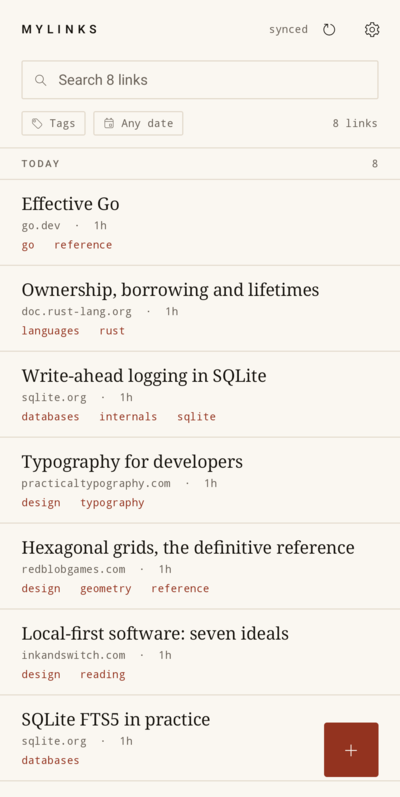
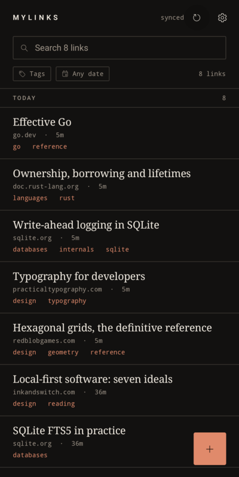
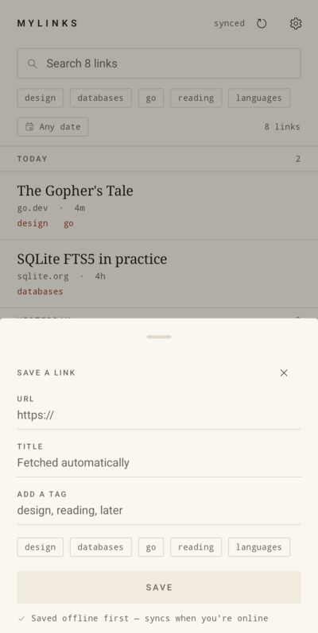
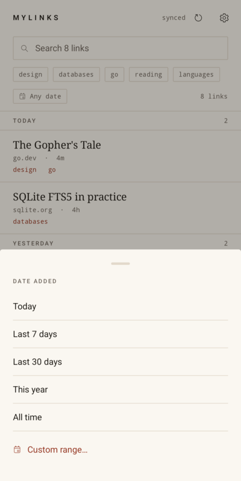
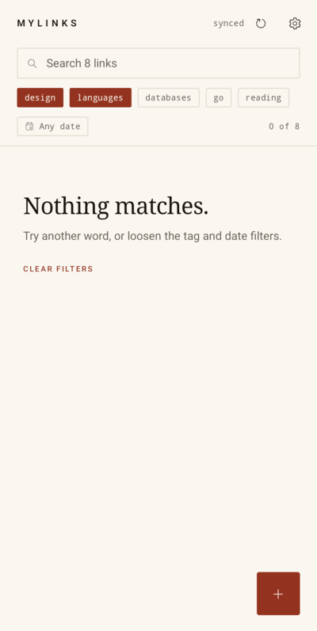
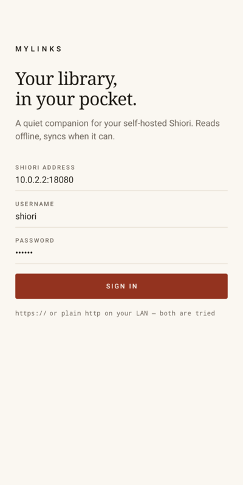

# MyLinks

An offline-first Android companion for a self-hosted [Shiori](https://github.com/go-shiori/shiori)
(1.8.x) library. Your links live on your phone; the server is where they are backed up and
shared with the web UI. No Google services, no analytics, no account beyond your own instance.

## What it does

- **Library that works on a plane.** Every bookmark is mirrored into local SQLite on first sync.
  Search, tags and date filters all run against the device, never the network.
- **Share target.** Share any link from a browser, feed reader or chat app; MyLinks opens a save
  sheet with the URL filled in. The bookmark is stored immediately and uploaded later.
- **Quick tags.** Type a tag or tap one of your frequently used ones while saving. Add a tag to an
  existing bookmark from its detail screen.
- **Quick filter.** Tap tag chips under the search field; the list narrows instantly. Chips
  combine as AND, and the selected ones float to the front.
- **Search by date.** Presets (today, 7 days, 30 days, this year) plus an arbitrary range from
  Material's range picker. The list is grouped under day headers.
- **Delayed sync.** Sync on launch, on resume, on pull-to-refresh, right after a save, and every
  6 hours in the background. Everything queued while offline is replayed in order.

## Screenshots

Captured on an AOSP Android 16 device image (no Google APIs) against a live Shiori 1.8.0.

| Library | Dark | Bookmark |
|---|---|---|
|  |  |  |
| Search, tag chips and day groups. Tags come from the server, colours from the palette. | Same palette at night. | Full URL, tags, and the two actions that matter. |

| Save a link | Date filter | Nothing matches |
|---|---|---|
|  |  |  |
| Opened from the share sheet with the URL already in place. | Presets plus an arbitrary range. | Tag filters are AND-ed, so this is the honest empty state. |

| Offline queue | Sign in |
|---|---|
|  |  |
| A link saved in airplane mode: accent dot, "1 queued", badge in the header. | A bare `host:port` works — https is tried, then plain http. |

## Use it

Requirements: Android 8.0 (API 26) or newer, and a reachable Shiori 1.8.x instance.

```bash
./build.sh :app:assembleDebug        # debug APK (debug key, installs as-is)
adb install -r app/build/outputs/apk/debug/app-debug.apk
```

`./build.sh` uses the toolchain staged in `.build-env/` (JDK 21, Gradle 8.14.6, Android SDK 36)
because this machine's `$HOME` is read-only. On a normal machine use `./gradlew` with your own
JDK 17+ and `ANDROID_HOME`.

### Building a signed release APK

`app-release.apk` is 1.65 MB (R8 + resource shrinking). Signing is opt-in: create a key once, then
release builds are signed with it; without a key the release APK is simply left unsigned.

```bash
keytool -genkeypair -keystore release.keystore -alias mylinks \
        -keyalg RSA -keysize 4096 -validity 10000
cat > keystore.properties <<EOF
storeFile=release.keystore
storePassword=your-password
keyAlias=mylinks
keyPassword=your-password
EOF

./build.sh :app:assembleRelease
# → app/build/outputs/apk/release/app-release.apk
.build-env/android-sdk/build-tools/36.0.0/apksigner verify --print-certs \
    app/build/outputs/apk/release/app-release.apk
```

`keystore.properties`, `*.keystore` and `dist/` are gitignored — the signing key never enters the
repository. Keep it: Android only replaces an installed app in place when the signature matches.

Sign in with the address of your instance. A bare `host:port` is fine — MyLinks tries `https`
first and falls back to plain `http`, which is what most LAN and funnel setups need.

## How offline and sync work

Two tables and a queue:

- `bookmarks` + `bookmark_tags` mirror the server. `server_id` is null for rows created on the
  phone and not yet uploaded; those show a small queued dot in the list.
- `outbox` holds pending mutations (`create`, `tag`, `delete`), replayed oldest-first on the next
  successful sync.

A sync is **push, then pull**:

1. Every outbox entry is replayed. A 4xx response drops the entry (the server will never accept
   it, so retrying forever would be wrong); network errors leave the queue intact for later.
2. The pull walks `/api/bookmarks?page=N`. A bookmark is "already mirrored" only when its
   modified time, title, url and tag set all match, so a server-side tag edit or a metadata
   refresh that lands in the same second still converges. Incremental mode stops at the first page
   where every bookmark matches, which is normally 1–2 requests.
3. Every 12 hours (and on every manual refresh) the pull is *full*: all pages are read and any
   mirrored bookmark the server no longer has is deleted locally. This is also how edits made in
   the web UI reach the phone.

Pull is last-writer-wins by `modifiedAt`. Local edits are never overwritten mid-queue because the
push happens first.

Sessions are Shiori's JWT with `rememberMe`, so they last 30 days; after that the sign-in screen
comes back with your server and username pre-filled. Shiori 1.8 has no bookmark endpoints on its
v1 API yet, so MyLinks talks to the legacy endpoints for bookmark CRUD.

## Design notes

The look is editorial rather than stock Material: warm paper, ink, a single oxblood accent,
hairlines instead of cards, an oversized serif for titles (the platform serif, so nothing is
downloaded) and monospace for metadata and dates. The list has no thumbnails on purpose — cover
images would need a network round trip and a disk cache that is useless offline, and the
type-only list is faster to scan.

## Constraints kept

- **No Google runtime.** No play-services, Firebase, Play Billing, Play Asset Delivery,
  downloadable fonts or Google-hosted runtime endpoint. WorkManager without play-services falls
  back to the platform JobScheduler, so background sync works on de-Googled ROMs. `google()` is
  still in `settings.gradle.kts` because that is where AndroidX libraries are published — that is
  a build-time fetch, not a runtime dependency.
- **Light.** No image loader, no DI framework, no navigation library, no JSON library, no
  Retrofit: `HttpURLConnection` + `org.json` (both platform) plus Compose and WorkManager. Icons
  are 12 small vector drawables exported from Material Design Light / Phosphor. Release builds are
  R8-minified and resource-shrunk.

## Verified on a device

The whole flow was exercised on an **AOSP Android 16 x86_64 emulator (no Google APIs at all)**
against a live Shiori 1.8.0: sign in, sync 9 bookmarks, day groups, search, tag filtering, date
filtering, empty state, detail, share target, offline save, reconnect, quick tag add and delete —
each step checked against both the app's SQLite file and the server's API.

That run found six real defects, all fixed:

- `PRAGMA busy_timeout` was executed through `execSQL`, which throws on Android: **crash on first
  open**.
- Shiori rewrites a bookmark right after fetching its metadata, and its timestamps have
  one-second resolution, so a same-second edit looked "already synced" and the fetched title
  never arrived. Freshness is now a content comparison (see below).
- The outbox queued tag additions **without the tag name**, so every sync sent an empty tag batch
  and the server panicked — an endless retry loop.
- Tag edits made on the server do not always bump `modifiedAt`, so the mirror could keep tags the
  server had dropped. `needsUpdate` now compares title, url and the tag set as well.
- The `+ tag` field on the detail screen opened without focus, so typing went nowhere.
- Both sheets clipped their footer behind the navigation bar.

## Verified against a real server

The client was developed against a live Shiori 1.8.0 build, not just its documentation, and two
things only the real server revealed are handled in `Api.kt`:

- **Responses are enveloped.** Shiori wraps JSON as `{"ok":true,"message":{...}}`. MyLinks sends
  `X-Shiori-Response-Format: new` (the server's documented opt-out) *and* unwraps defensively, so
  it works whether or not the envelope is present.
- **The login field is `expires`**, although the swagger annotation says `expiration`. Both are
  read.

`scripts/e2e.sh` boots a throwaway Shiori on 127.0.0.1:18080 (building it from the v1.8.0 tag if
needed) and runs the contract tests: sign in, create a bookmark, add a tag, find it on page 1 with
parsed UTC timestamps, delete it, and confirm a wrong password and a scheme-less LAN address both
behave.

## Layout

```
app/src/main/java/net/reddec/mylinks/
  data/Api.kt      Shiori HTTP client (login, page, create, addTags, delete)
  data/Store.kt    all SQLite reads/writes, outbox
  data/Sync.kt     push-then-pull reconciliation
  data/Time.kt     server timestamp parsing, relative dates, day headers
  data/Links.kt    share-text URL extraction, server address candidates
  work/           WorkManager 6-hourly sync
  ui/             theme, library, save sheet, detail, settings, sign-in
  MyLinksViewModel.kt, MainActivity.kt
```

## Endpoints used

| Purpose | Endpoint |
|---|---|
| Sign in | `POST /api/v1/auth/login` → JWT |
| List (paged, 30/page) | `GET /api/bookmarks?page=N` |
| Create | `POST /api/bookmarks` |
| Add tags | `PUT /api/bookmarks/tags` |
| Delete | `DELETE /api/bookmarks` |

All requests send `Authorization: Bearer <token>`.

## Tests

```bash
./build.sh :app:testDebugUnitTest    # 11 hermetic unit tests
./scripts/e2e.sh                     # + 3 contract tests against a live Shiori 1.8.0
```

The emulator run is reproducible too: `avdmanager create avd -n mylinks -k
"system-images;android-36;default;x86_64"` boots an image with no Google services, which is also
how the "no GApps" claim was tested rather than assumed.

Unit tests cover timestamp parsing (SQLite UTC strings, ISO with zone), relative/grouped date
rendering, share-text URL extraction and server-address candidates. The e2e tests are skipped
unless `MYLINKS_E2E_SERVER` is set, so the normal suite never touches the network.

## Known limits

- Tag removal from a bookmark, renames and bulk edits are not implemented (Shiori needs a full
  `PUT /api/bookmarks` for that); tag *additions* are.
- Search is local only, so it cannot match archived page bodies that were never mirrored.
- One server, one account per install.
- The JWT is stored in the app's private `SharedPreferences`, not encrypted with the Keystore.
- Cleartext HTTP is allowed app-wide so LAN instances work; use https for anything exposed.
- Verified on an AOSP emulator, not on physical hardware: real-device fonts metrics, gesture
  navigation and OEM quirks are still unseen.
- Incremental sync only sees *new* bookmarks quickly; edits made in the web UI arrive with the
  next full pull (at most 12 hours, or immediately on pull-to-refresh).
